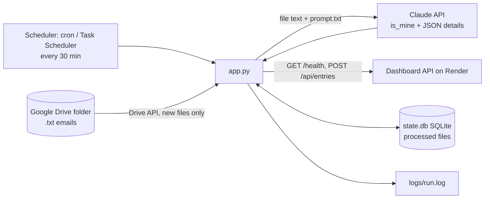

# Trainer Central -> Dashboard Automation

Local Python app that reads Trainer Central submission emails (.txt) from a shared Google Drive folder, uses Claude to decide which are mine and extract details, and pushes them to the dashboard API. Runs every 30 minutes with no manual trigger.

Participant: **upendarduggineni** (upendarduggineni24@gmail.com)

## Architecture



Flow per run: list `.txt` files -> skip IDs already in `state.db` -> read file -> Claude returns JSON -> if mine, wake API (`/health`), check it is not already on the dashboard, `POST /api/entries` with `sender` = my name -> record the file as processed.

## Setup

1. **Python 3.10+**, then in this folder:
   ```
   python -m venv venv
   # Windows: venv\Scripts\activate     Mac/Linux: source venv/bin/activate
   pip install -r requirements.txt
   ```
2. **Config:** copy `.env.example` to `.env` and fill in `ANTHROPIC_API_KEY`, `DRIVE_FOLDER_ID` (the last part of the folder URL `drive.google.com/drive/folders/<ID>`), and `DASHBOARD_API_KEY` only if the trainer says it is required.
3. **Google Drive access (one time):**
   - Google Cloud Console -> create a project -> enable **Google Drive API**.
   - OAuth consent screen -> External -> add yourself as a test user (also publish to "In production" to avoid the 7-day refresh-token expiry of Testing mode).
   - Credentials -> Create **OAuth client ID** -> *Desktop app* -> download as `credentials.json` into this folder.
   - Run `python app.py --auth` and sign in with the Google account that can see the shared folder. This saves `token.json`, which refreshes itself for unattended runs.
4. **Test manually once:** `python app.py` and check `logs/run.log`.

## Scheduling (every 30 minutes)

**Windows (Task Scheduler)** - run in Command Prompt, adjusting the path:
```
schtasks /create /tn "TrainerCentralSync" /sc minute /mo 30 /tr "C:\path\to\trainer_central_automation\run_windows.bat"
```

**Mac/Linux (cron)** - `crontab -e` and add:
```
*/30 * * * * /path/to/trainer_central_automation/run_unix.sh >> /path/to/trainer_central_automation/logs/cron.log 2>&1
```
The computer must be on and awake (not sleeping) for runs to happen.

## How requirements are met

| Req | How |
|---|---|
| R1 | Drive API lists `.txt` files; only unseen file IDs are processed |
| R2/R3 | `prompt.txt` makes Claude return JSON: `is_mine`, assignment name, submission time, status, other details |
| R4 | `POST /api/entries` with `text` and `sender` |
| R5 | `state.db` records processed file IDs; also checks `GET /api/entries` for a `[drive-file:<id>]` marker before posting |
| R6/R7 | OS scheduler every 30 min, runs locally |
| R8 | Retries with backoff on Drive, Claude and API calls; empty/unrelated files skipped; one bad file never stops the run; failed files are retried next run; everything logged to `logs/run.log` |

## Real email format (from sample files)

Each file is a TrainerCentral notification with headers (`Date`, `Message ID`) and one body sentence naming the learner's **email address** (not their name), the assignment topic and the course. So matching is done on `upendarduggineni24@gmail.com`; submission time is taken from the `Date:` header (UTC); status is "Submitted"; the course, message ID and submission ID go into the details.

## Assumptions

- `sender` is always `upendarduggineni`, so the dashboard groups all entries under one learner.
- A file is marked processed only after a definitive outcome (pushed, not mine, empty). API or Claude failures are retried on the next run.
- The response from `POST /api/entries` is expected to contain `id` or `entry_id`; if not, the entry is still counted as pushed.
- Secrets live only in `.env`, `token.json` and `credentials.json`, which are git-ignored and must not be submitted.

## Testing checklist

- Email for another participant -> logged "not mine", nothing posted
- Empty file -> skipped
- Run twice -> no second entry
- Disconnect internet -> logs the error, exits cleanly, recovers next run
